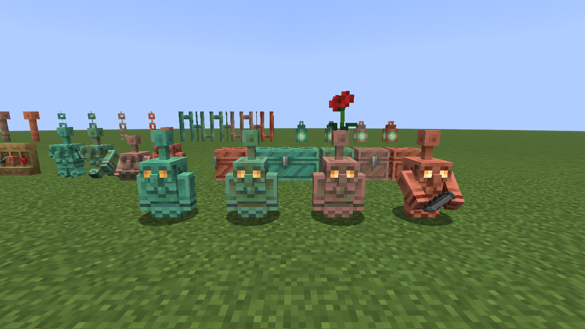
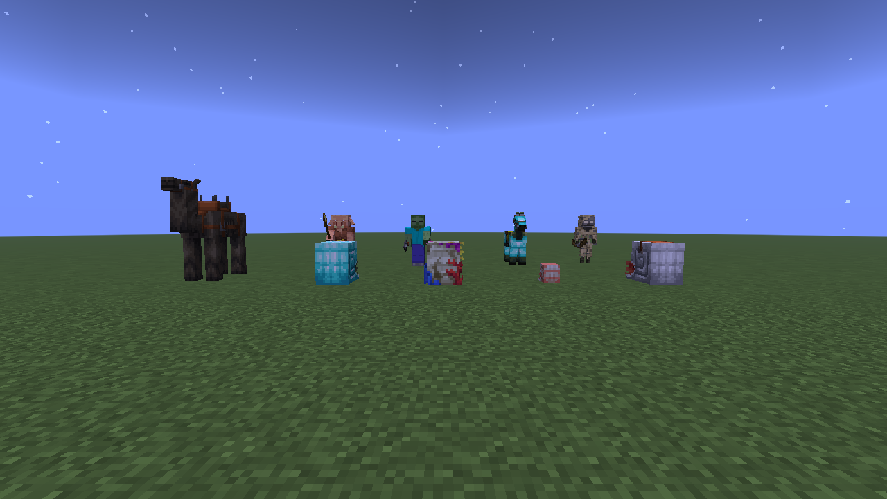
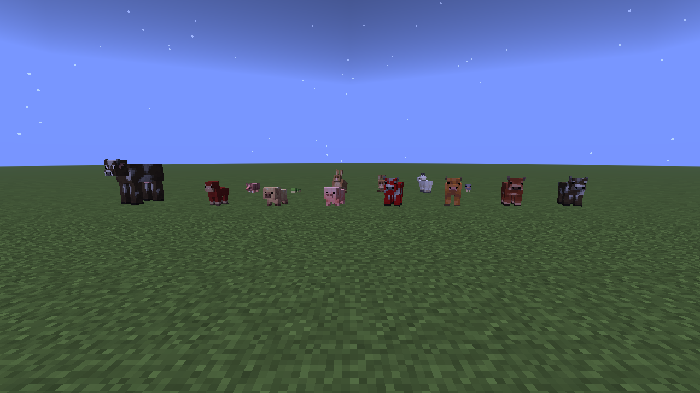
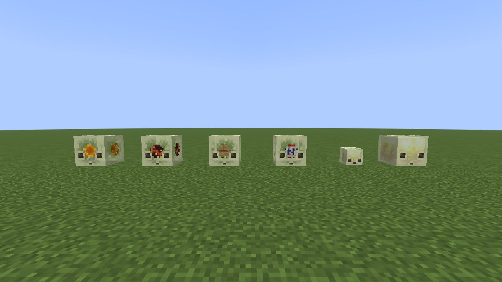
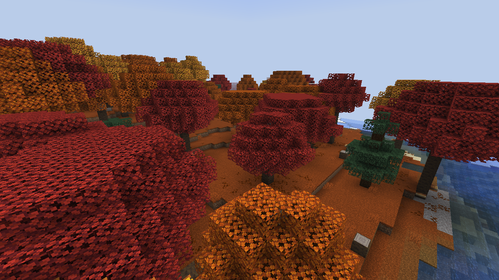

# Everything Backport

A Fabric mod that brings newer Minecraft content to **1.21.7**: copper golems, nautiluses, redesigned baby mobs, sulfur caves and poplar forests.



## What's included

| Backport | Content |
| --- | --- |
| The Copper Age (1.21.9) | Copper golems and chests, shelves, copper tools and armor, lanterns, torches, bars and chains. |
| Mounts of Mayhem (1.21.11) | Spears and Lunge, nautiluses and their equipment, camel husks and new jockeys. |
| Tiny Takeover (26.1) | Redesigned baby mobs, golden dandelions that pause aging, sound variants and the trumpet. |
| Chaos Cubed (26.2) | Sulfur cubes, sulfur caves, cinnabar and sulfur building blocks, spikes and geysers. |
| Wilderness Bound (26.3) | Poplar trees and wood, dappled forests, abandoned camps, cushions, straw beds and shelf mushrooms. |

The mannequin is not ported. Chaos Cubed's changes to bed and sign rendering are also not included.

## Install

You need **Minecraft 1.21.7**, **Java 21**, Fabric Loader and Fabric API. The development setup uses Loader **0.18.1** and Fabric API **0.129.0+1.21.7**.

1. Install [Fabric Loader](https://fabricmc.net/use/installer/) for Minecraft 1.21.7.
2. Put [Fabric API](https://modrinth.com/mod/fabric-api/versions?g=1.21.7) for 1.21.7 in your `mods` folder.
3. Add the Everything Backport jar from [Releases](https://github.com/Ze-Chr0ME/everything_backport/releases).

Install the mod and Fabric API on **both the server and every player's client**. For singleplayer, install them in your client.

## Screenshots

Captured in the mod's client game-test worlds on Minecraft 1.21.7.


*Mounts of Mayhem.*


*Tiny Takeover.*


*Chaos Cubed.*


*Wilderness Bound.*

## Worlds and compatibility

Backported content uses vanilla `minecraft:` IDs and block-state properties. This is intended to let the content carry over when a world moves to a newer Minecraft version; keep a backup before upgrading.

World generation is designed to work alongside TerraTonic (Terralith + Tectonic), keeping the world's biome source and noise settings. New structures appear in newly generated chunks. Sulfur caves replace matching climate regions while preserving other underground biomes, including those tagged `c:is_underground`.

The mod shares its Minecraft, Loader and Fabric API versions with `fabric_skills_mod` for use in the same modpack.

## Build and run

With JDK 21 installed:

```sh
./gradlew build
./gradlew runClient
```

On Windows, use `gradlew.bat` in place of `./gradlew`. The built mod is `build/libs/everything_backport-0.2.0.jar`; the `-sources.jar` is for development.

### Client game tests

```sh
./gradlew runClientGameTest
```

This launches a real Minecraft client. The active test is selected by the `fabric-client-gametest` entrypoint in [the test manifest](src/gametest/resources/fabric.mod.json), currently Wilderness Bound. Test classes for all five backports live in [src/gametest](src/gametest/java/backport/everything_backport/test); they build scenes and check behavior such as copper golem sorting, spear attacks, age locking and world generation.

Screenshots are saved to `build/run/clientGameTest/screenshots/`.

## Credits

Vanilla textures, models and sounds belong to Mojang Studios. This is an unofficial project, not affiliated with Mojang or Microsoft.
